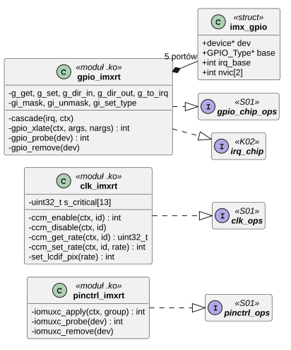
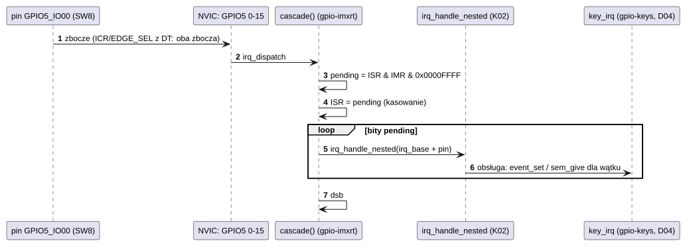

# D01 Sterowniki platformy: piny, zegary, GPIO

## 1. Identyfikacja

| | |
|---|---|
| Identyfikator | D01 |
| Warstwa | L1 (moduły `.ko`) |
| Moduły | `pinctrl-imxrt.ko` (`fsl,imxrt1050-iomuxc`), `clk-imxrt.ko` (`fsl,imxrt1050-ccm`), `gpio-imxrt.ko` (`fsl,imxrt1050-gpio`); STM32H7S7: `pinctrl-stm32.ko` (`st,stm32h7rs-pinctrl`), `clk-stm32.ko` (`st,stm32h7rs-rcc`), `gpio-stm32.ko` (`st,stm32h7rs-gpio`, `st,stm32h7rs-exti`) |
| Pliki | `drivers/imxrt/pinctrl-imxrt.c`, `clk-imxrt.c`, `gpio-imxrt.c`; stałe DT: `dts/include/dt-bindings/clock/imxrt1050-clock.h`, `dts/include/imxrt1050-pinfunc.h`; `drivers/stm32/pinctrl-stm32.c`, `clk-stm32.c`, `gpio-stm32.c` (rejestry z CMSIS `stm32h7rsxx.h`, bez HAL); stałe DT: `dts/include/dt-bindings/clock/stm32h7rs-clock.h`, `dts/include/dt-bindings/pinctrl/stm32-pinctrl.h` |
| Interfejsy realizowane | `pinctrl_ops`, `clk_ops`, `gpio_chip_ops`, `irq_chip`, domena przerwań (S01, K02) |

## 2. Odpowiedzialność

- **pinctrl-imxrt**: konfiguracja padów IOMUXC z grup `fsl,pins` (multiplekser, wybór
  wejścia „daisy”, konfiguracja padu).
- **clk-imxrt**: bramki zegarów CCGR i korzenie zegarów (UART, LPI2C, LPSPI, USDHC, LCDIF,
  ENET, SAI1), obliczanie częstotliwości, ustawianie wybranych korzeni (np. zegar pikseli LCD
  z PLL wideo), ochrona zegarów, z których korzysta jądro.
- **gpio-imxrt**: porty GPIO1–GPIO5 (32 piny każdy), odczyt/zapis/kierunek, przerwania
  pinów jako drugorzędny kontroler przerwań (dwie linie NVIC na port → 32 numery
  wirtualne), tłumaczenie `<&gpioN pin typ>` z DT.

Na STM32H7S78-DK to samo robią moduły STM32 (te same interfejsy S01 i K02):

- **pinctrl-stm32**: grupy jak w Linuksie i Zephyrze: `pinmux = <STM32_PINMUX(port, pin,
  funkcja)>` (funkcja alternatywna AF0–AF15, `ANALOG` albo `GPIO`), wspólne dla grupy
  `bias-pull-up`/`bias-pull-down`, `drive-open-drain`, `slew-rate` (0–3); włącza zegar portu.
- **clk-stm32**: bramki RCC (`STM32_CLK(rejestr, bit)`, częstotliwość = zegar szyny) i zegary
  jądra: PLL3 R (zegar pikseli LTDC, D03), PLL3 Q (I2S do kodeka, D09), HSI48 (RNG, USB FS),
  LSE (RTC). PLL1 (rdzeń, szyny) i PLL2 (XSPI, karta SD) ustawia raz program startowy (K18);
  sterownik ich nie zmienia. PLL3 dzielą ekran i dźwięk.
- **gpio-stm32**: porty GPIOA–H i M–P (16 pinów), odczyt/zapis/kierunek, tłumaczenie
  `<&gpioX pin typ>`; przerwania pinów przez EXTI: 16 linii (numer pinu), każda z własnym
  wektorem NVIC (EXTI0–15) i 16 numerami wirtualnymi; linia obsługuje naraz jeden port (wybór
  w SBS `EXTICR`).

## 3. Wymagania

| ID | Wymaganie | Weryfikacja |
|---|---|---|
| REQ-D01-01 | Bramki zegarów urządzeń używanych przez jądro (konsola LPUART1, USDHC1, IOMUXC, GPIO1–5, SEMC, OCRAM, FlexSPI, DMA; STM32H7S7: konsola UART4, SDMMC1, XSPI1, XSPI2, XSPIM, SBS i porty GPIO) nigdy nie są wyłączane przez `clk_disable`. | przegląd kodu |
| REQ-D01-02 | Zmiana korzenia zegara UART (wspólnego z konsolą) jest odrzucana (`-EBUSY`), chyba że nie zmienia częstotliwości. | przegląd kodu |
| REQ-D01-03 | Grupa pinów z `fsl,pins` o długości niepodzielnej przez 24 B jest odrzucana (`-EINVAL`), zanim cokolwiek zostanie zapisane. | przegląd kodu |
| REQ-D01-04 | Zbocze przerwania pinu zapamiętane, gdy linia była zamaskowana, jest kasowane przy odmaskowaniu (STM32: EXTI `PR1`). | przegląd kodu, SW8 (`evtest`) |
| REQ-D01-05 | Obsługa kaskady kasuje flagi przed wywołaniem obsług pinów (nowe zbocza w trakcie nie giną; STM32: EXTI `PR1` przed `irq_handle_nested`). | przegląd kodu |
| REQ-D01-06 | Zegar pikseli ma zadaną częstotliwość także przy kolejnych zmianach: przed nowym dzielnikiem post PLL wideo stary jest kasowany (przy obejściu PLL), bo `CLOCK_InitVideoPll` z SDK nakłada nowy na stary. | `kmon fb` + `fbtest` (02.10.2026): 10 zmian 480×272 ↔ 800×480, 58,7 i 59,1 Hz; przed poprawką druga zmiana dała 18,6 MHz zamiast 9,3 MHz (117 Hz) |
| REQ-D01-07 | `gpio-stm32`: linia EXTI (numer pinu) należy naraz do jednego portu. Prośba o przerwanie pinu o tym samym numerze z innego portu kończy się `-EBUSY`, a dotychczasowe przypisanie linii (SBS `EXTICR`) zostaje. | przegląd kodu |
| REQ-D01-08 | `clk-stm32`: zmiana zegara dźwięku (PLL3 Q), którą osiąga sama część ułamkowa VCO, nie zatrzymuje PLL3. Inna zatrzymuje go i uruchamia z nowymi N, Q i dzielnikiem R wyliczonym tak, by zegar pikseli był najbliższy ostatnio zadanemu (ekran gubi ramkę). Czekanie na zatrzymanie i gotowość PLL3 ma limit 10 ms (`-ETIMEDOUT`). | przegląd kodu |

Pozostałe wymagania dotyczą `clk-imxrt` (REQ-D01-02, 06) i `pinctrl-imxrt` (REQ-D01-03).
`clk-stm32` nie zmienia zegarów szyn (`set_rate` tylko dla PLL3 R i Q, inne `-EINVAL`), więc
odpowiednik REQ-D01-02 nie jest potrzebny.

## 4. Interfejs udostępniany

Brak funkcji wołanych bezpośrednio; moduły rejestrują się we frameworkach S01 i K02:

| Moduł | Rejestracja | Operacje |
|---|---|---|
| `pinctrl-imxrt` | `pinctrl_register(węzeł IOMUXC)` | `apply(grupa)`: dla każdego 6-komórkowego wpisu: `MUX = tryb (+ SION z bitu 30 konfiguracji)`, `daisy = wartość` (jeśli jest rejestr), `PAD = konfiguracja` (chyba że bit 31 „nie zmieniaj”) |
| `clk-imxrt` | `clk_provider_register(węzeł CCM)` | `enable`: bramka `CLOCK_EnableClock` (id < `0x1000`) albo PLL ENET 50 MHz; `disable`: bramka poza listą krytycznych; `get_rate`: CPU, AHB, IPG, PER, SEMC, UART, LPI2C, LPSPI, USDHC1, LCDIF, ENET; `set_rate`: LCDIF (pełne przeszukanie PLL wideo), LPI2C, LPSPI, UART (tylko bez zmiany) |
| `gpio-imxrt` | `gpiochip_register`, `irq_alloc_descs(32)`, `irq_domain_add`, `irq_request` × 2 (priorytet 8) | `get` (DR dla wyjść, PSR dla wejść), `set` (DR_SET/DR_CLEAR), kierunek (GDIR pod `irq_lock`), `to_irq`, `mask`/`unmask` (IMR), `set_type` (ICR1/2, EDGE_SEL) |
| `pinctrl-stm32` | `pinctrl_register(węzeł pinctrl)` | `apply(grupa)`: dla każdej 4-bajtowej komórki `pinmux` (pod `irq_lock`): zegar portu, `PUPDR` z `bias-*`; `ANALOG`: `MODER` = 3; `GPIO`: wejście (gdy pin był analogowy albo alternatywny), `OTYPER`, `OSPEEDR`; AF: `AFR`, `OTYPER`, `OSPEEDR`, `MODER` = 2 |
| `clk-stm32` | `clk_provider_register(węzeł RCC)` | `enable`: bramka `*ENR` (pod `irq_lock`) albo zegar jądra (HSI48; LSE z odblokowaniem domeny zapasowej; PLL3 R; PLL3 Q z wyborem `SPI6SEL`); `disable`: bramka poza listą krytycznych i portami GPIO; `get_rate`: zegar szyny bramki (HCLK, PCLK1/2/4/5), PLL3 R i Q, 48 MHz, 32768 Hz; `set_rate`: PLL3 R (najbliższy dzielnik 1–128), PLL3 Q (REQ-D01-08) |
| `gpio-stm32` | EXTI: `irq_alloc_descs(16)`, `irq_request` × 16 (priorytet 8); port: `irq_domain_add`, `gpiochip_register(16)` | `get` (ODR dla wyjść, IDR dla wejść), `set` (`BSRR`), kierunek (`MODER` pod `irq_lock`), `to_irq` (przypisanie linii EXTI, REQ-D01-07), `mask`/`unmask` (`IMR1`), `set_type` (`RTSR1`/`FTSR1`) |

## 5. Interfejsy wymagane

S01, K02 (`irq_request`, `irq_alloc_descs`, `irq_handle_nested`, `irq_domain_add`), K17
(`device_map`, `device_get_irq`, `devm_*`), NXP SDK `fsl_clock` (w obrazie jądra,
eksportowany przez `ksyms`). STM32: rejestry RCC, GPIO, EXTI, SBS i PWR wprost (CMSIS),
`SystemCoreClock` i `cpu_cycles` jądra.

## 6. Struktura statyczna

*Źródło: [D01/struktura-statyczna.puml](../diagramy/D01/struktura-statyczna.puml)*

## 7. Zachowanie dynamiczne

*Źródło: [D01/przerwanie-pinu-gpio.puml](../diagramy/D01/przerwanie-pinu-gpio.puml)*

## 8. Implementacja

- Wszystkie trzy moduły wiążą się z węzłami `dts/imxrt1052.dtsi`; drzewo płytki
  (`evkbimxrt1050.dts`) opisuje grupy pinów urządzeń.
- `pinctrl-imxrt` zapisuje adresy rejestrów wprost z DT (tak jak makra SDK `IOMUXC_*`),
  generowane do `dts/include/imxrt1050-pinfunc.h` narzędziem `tools/gen_pinfunc.py`.
- `clk-imxrt`: identyfikatory < `0x1000` to bramki w kodowaniu `clock_ip_name_t` SDK;
  ≥ `0x1000` to korzenie (tylko częstotliwość, włączenie nic nie robi, poza ENET_REF).
  Zegar pikseli: przegląd pętli PLL wideo 27–54, dzielników post (1–16), pre (1–8)
  i LCDIF (1–8) – najmniejszy błąd. Przed `CLOCK_InitVideoPll` PLL jest obchodzony,
  a pole `POST_DIV_SELECT` kasowane: SDK łączy nowy dzielnik ze starym bitowym OR (z /1 na /2
  dawało wartość 3, czyli /1, i dwa razy szybszy zegar). Zegar dźwięku (`SAI1_ROOT`, D09): PLL audio na 64-krotność
  żądanej częstotliwości (10–20 MHz), podzielona przez 4 i 16.
- `gpio-imxrt`: kierunek zmieniany pod `irq_lock` (odczyt-modyfikacja-zapis GDIR),
  wartości przez rejestry ustaw/kasuj (atomowe).
- **STM32H7S7** (węzły `dts/stm32h7s7.dtsi`, grupy pinów w `dts/stm32h7s78dk.dts`):
  - `pinctrl-stm32`: komórka `pinmux` = port << 12 | pin << 8 | funkcja; porty I–L nie
    istnieją. Pin `GPIO` dostaje tylko podciąganie, typ i szybkość wyjścia, kierunek ustawia
    sterownik GPIO.
  - `clk-stm32`: identyfikator = przesunięcie rejestru `*ENR` << 8 | bit; `STM32_KERNEL`
    (0xf00) to zegary jądra. Zegar pikseli: dzielnik R najbliższy żądanej częstotliwości (przy
    VCO 614,4 MHz i 25 MHz z DT: 24,576 MHz). Zegar dźwięku: najpierw sama część ułamkowa
    przy tych samych N i Q; gdy N musiałby się zmienić, Q dające VCO najbliższe 614,4 MHz
    (zakres 400–1600 MHz, N 8–420) i restart PLL3 (REQ-D01-08).
  - `gpio-stm32`: jeden moduł, dwa sterowniki: EXTI (wspólny dla portów, przydziela 16
    numerów wirtualnych i woła `irq_request` dla 16 wektorów) i porty. Port przypisuje sobie
    linię przy `to_irq` albo tłumaczeniu z DT (`interrupt-parent` = port). EXTI zna tylko
    zbocza: wyzwalanie poziomem jest przyjmowane jako zbocze do tego poziomu. Wartości przez
    `BSRR` (atomowo), kierunek pod `irq_lock`.

## 9. Obsługa błędów i mechanizmy bezpieczeństwa

| Sytuacja | Reakcja |
|---|---|
| zła długość `fsl,pins` | `-EINVAL` |
| zegar CCM niedostępny przy `probe` pinów/GPIO | `-EPROBE_DEFER` |
| wyłączenie zegara krytycznego | pominięte |
| zmiana zegara UART | `-EBUSY` |
| ponowna zmiana zegara pikseli | stary dzielnik post skasowany przed nowym (REQ-D01-06) |
| brak linii przerwania portu | `-EBUSY`, zwolnienie numerów wirtualnych |
| STM32: zła długość `pinmux` | `-EINVAL` przed zapisem |
| STM32: wpis `pinmux` z portem I–L albo nieznaną funkcją | `-EINVAL`; wcześniejsze piny grupy zostają ustawione |
| STM32: linia EXTI zajęta przez inny port | `-EBUSY` (REQ-D01-07) |
| STM32: PLL3 nie zatrzymuje się albo nie startuje w 10 ms | `-ETIMEDOUT` |
| STM32: zegar dźwięku poza zakresem VCO albo N | `-ERANGE`, PLL3 bez zmian |
| STM32: `set_rate` innego zegara niż PLL3 R i Q | `-EINVAL` |

## 10. Konfiguracja

Węzły `iomuxc`, `ccm`, `gpio1..gpio5` w `dts/imxrt1052.dtsi`; lista zegarów krytycznych
`s_critical` w `clk-imxrt.c`. STM32: węzły `rcc`, `pinctrl`, `exti`, `gpioa..gpiop`
w `dts/stm32h7s7.dtsi`, grupy pinów w `&pinctrl` płytki; `s_critical`, `VCO_TARGET`
(614,4 MHz) i `HSE_HZ` (24 MHz) w `clk-stm32.c`.

## 11. Weryfikacja

- Każdy start: `clock controller: cpu 600 MHz, ahb 600 MHz, ipg 150 MHz`, `32 GPIOs, IRQs ...`
  (`crtos kmon dmesg`), wszystkie urządzenia dołączone (`devices`).
- SW8 i przerwanie dotyku przez GPIO (`evtest`, ręcznie).
- STM32H7S78-DK: log startu (`core 600 MHz, AHB 300 MHz, APB 150 MHz, PLL3 …`,
  `EXTI lines 0-15 as IRQs …`), `devices`; przycisk USER i przerwanie dotyku przez EXTI
  (`evtest`).

## 12. Ograniczenia i znane problemy

- `rmmod` tych modułów jest możliwy mimo aktywnych odbiorców (licznik odwołań 0) i zostawia
  wiszące uchwyty (S01, [03 Analiza bezpieczeństwa](../03-analiza-bezpieczenstwa.md)).
- Brak kontroli konfliktów pinów między grupami różnych urządzeń.
- STM32: piny o tym samym numerze z dwóch portów nie mogą mieć przerwań naraz (jedna linia
  EXTI na numer). Wyzwalanie poziomem działa jak zboczem: linia, która zostaje aktywna, nie
  zgłasza się ponownie.
- STM32: błędny wpis w środku grupy `pinmux` zostawia wcześniejsze piny ustawione (z góry
  sprawdzana jest tylko długość).
- STM32: PLL3 jest wspólny dla ekranu i dźwięku. Zmiana rodziny częstotliwości dźwięku
  (48 kHz ↔ 44,1 kHz, także 32 kHz) restartuje go: ekran gubi ramkę, a zegar pikseli wychodzi
  z innego VCO (przy 44,1 kHz ok. 25,4 MHz zamiast 24,576 MHz).
