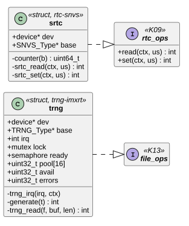
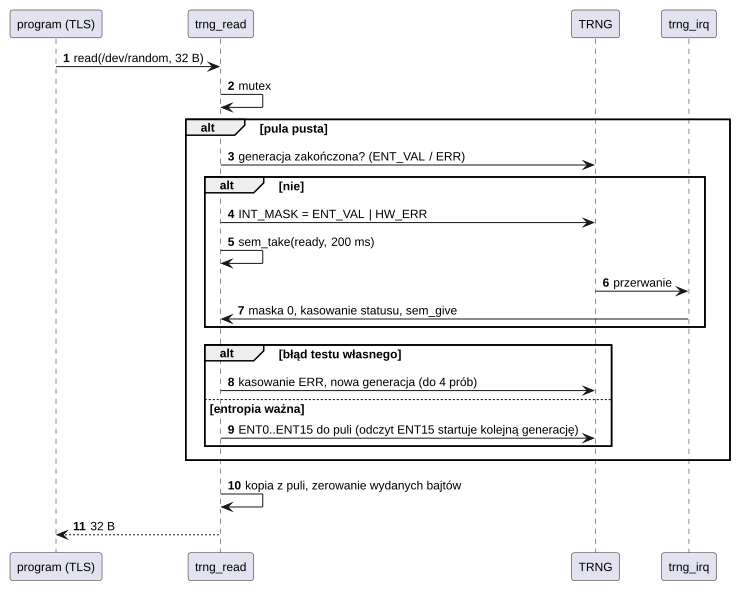
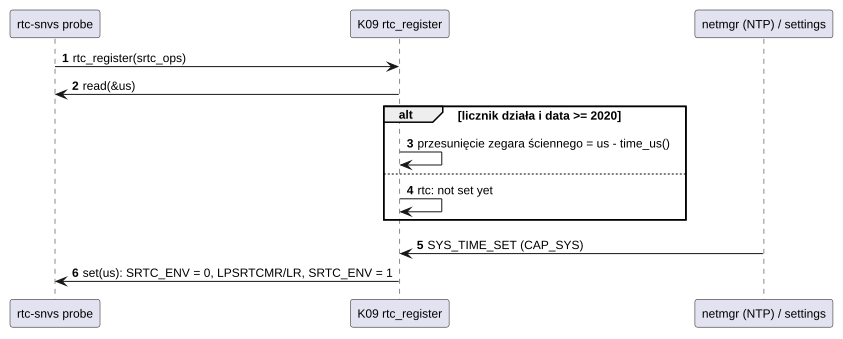

# D08 Generator liczb losowych i zegar RTC

## 1. Identyfikacja

| | |
|---|---|
| Identyfikator | D08 |
| Warstwa | L1 (moduły `.ko`) |
| Moduły | `trng-imxrt.ko` (`fsl,imxrt1050-trng`), `rtc-snvs.ko` (`fsl,imxrt1050-snvs-rtc`); STM32H7S7: `rng-stm32.ko` (`st,stm32-rng`), `rtc-stm32.ko` (`st,stm32-rtc`) |
| Pliki | `drivers/misc/trng-imxrt.c` (+ SDK `fsl_trng.c`), `drivers/rtc/rtc-snvs.c`; `drivers/misc/rng-stm32.c`, `drivers/rtc/rtc-stm32.c` (rejestry, bez HAL) |
| Interfejsy realizowane | `file_ops` `/dev/random`, `/dev/urandom` (K13); `rtc_ops` (K09, `crtos/rtc.h`) |

## 2. Odpowiedzialność

- **trng-imxrt**: sprzętowy generator liczb prawdziwie losowych (oscylator pierścieniowy
  z testami statystycznymi): 512 bitów entropii na generację, każdy bit wydawany raz,
  bez programowej puli, którą dałoby się przewidzieć; źródło kluczy TLS przeglądarki
  (A02) i losowości programów.
- **rtc-snvs**: licznik SRTC domeny SNVS_LP (32,768 kHz, 47 bitów), który nie jest
  zerowany resetem (a z baterią na VDD_SNVS także wyłączeniem zasilania); źródło daty
  zegara ściennego po starcie i miejsce zapisu daty ustawionej przez NTP albo program
  Settings.
- **rng-stm32** (STM32H7S78-DK): generator RNG układu (szum swobodnych oscylatorów,
  kondycjonowanie sprzętowe, zegar HSI48): 32 bity na odczyt `DR`, nowe słowo co kilkaset
  ns, czytelnik odpytuje (bez przerwania); każde słowo wydawane raz. Te same pliki
  `/dev/random` i `/dev/urandom`; zapis jest przyjmowany i pomijany.
- **rtc-stm32**: RTC układu – kalendarz BCD (data, czas i licznik części sekundy, 1/256 s)
  z kwarcu LSE 32,768 kHz w domenie zapasowej, której reset nie zeruje (z VBAT także
  wyłączenie zasilania); trzyma UTC, lata 2000–2099. Ta sama rola co `rtc-snvs`.

## 3. Wymagania

| ID | Wymaganie | Weryfikacja |
|---|---|---|
| REQ-D08-01 | Odczyt `/dev/random` zwraca wyłącznie bity z generacji, której testy własne się powiodły; bity są zerowane po wydaniu. | przegląd kodu |
| REQ-D08-02 | Nieudany test własny TRNG jest kasowany i generacja powtarzana (do 4 razy), potem odczyt kończy się `-EIO`. | przegląd kodu |
| REQ-D08-03 | Jeden czytelnik naraz; odczyt ≤ 4096 B na wywołanie; limit czasu generacji 200 ms. | przegląd kodu |
| REQ-D08-04 | Licznik SRTC jest odczytywany do dwóch zgodnych odczytów (spójność połówek 47-bitowej wartości). | przegląd kodu |
| REQ-D08-05 | Nieustawiony licznik (SRTC wyłączony) nie podaje daty (`-EAGAIN`); data sprzed 2020 r. jest ignorowana przez jądro. | przegląd kodu, start po wyjęciu baterii |
| REQ-D08-06 | `rng-stm32` wydaje tylko słowa odczytane przy `DRDY`, bez błędu ziarna ani zegara (`SECS`, `SEIS`, `CECS`) i różne od 0. Po błędzie albo braku słowa w 10 ms kondycjonowanie jest resetowane (`CONDRST`) i odczyt próbuje dalej; po 4 nieudanych próbach kończy się `-EIO` (albo liczbą bajtów wydanych wcześniej). Jeden czytelnik naraz, ≤ 4096 B na wywołanie. | przegląd kodu |
| REQ-D08-07 | `rtc-stm32`: kalendarz nigdy nieustawiony (`ICSR.INITS` = 0) nie podaje daty (`-EAGAIN`); odczyt bierze `SSR`, `TR` i `DR` z jednej chwili (odczyt `SSR` zamraża rejestry cienia do odczytu `DR`). Data spoza lat 2000–2099 nie jest zapisywana (`-ERANGE`). | przegląd kodu |
| REQ-D08-08 | `rtc-stm32` nie zmienia źródła zegara RTC, gdy w domenie zapasowej wybrane jest już inne niż LSE (`-EBUSY` przy `probe`, bez resetu domeny, który skasowałby kalendarz). Zapis daty czeka na tryb inicjalizacji i na synchronizację rejestrów najwyżej 100 ms (`-ETIMEDOUT`). | przegląd kodu |

REQ-D08-01–05 opisują `trng-imxrt` i `rtc-snvs`; ich odpowiedniki na STM32 to
REQ-D08-06–08. Próg 2020 r. z REQ-D08-05 stosuje jądro (K09) dla obu płytek.

## 4. Interfejs udostępniany

| Moduł | Interfejs | Opis |
|---|---|---|
| `trng-imxrt` | `/dev/random`, `/dev/urandom` (bez `CAP_DEV`) | `read(buf, len)`: bajty entropii (czeka na generację), `-EIO`, `-EINTR` |
| `rtc-snvs` | `rtc_register(ops)` (K09) | `read(&us)`: µs od 1970 albo `-EAGAIN`; `set(us)`: zatrzymanie licznika, zapis, start |
| `rng-stm32` | `/dev/random`, `/dev/urandom` (bez `CAP_DEV`) | `read(buf, len)`: bajty entropii (odpytywanie, ≤ 4096 B), `-EIO`, `-EINTR`; `write`: przyjęte i pominięte |
| `rtc-stm32` | `rtc_register(ops)` (K09) | `read(&us)`: µs od 1970 (rozdzielczość 1/256 s) albo `-EAGAIN`; `set(us)`: tryb inicjalizacji, dzielniki 127 i 255 (1 Hz), data i czas, wyjście; `-EINVAL` (przed 1970), `-ERANGE`, `-ETIMEDOUT` |

Zegar ścienny (`SYS_TIME_GET`/`SYS_TIME_SET`, `settimeofday`) obsługuje K09; `rtc-snvs`
(`rtc-stm32`) jest tylko jego trwałym zapisem.

## 5. Interfejsy wymagane

K02 (przerwanie TRNG, priorytet 8), K06 (mutex, semafor), K13 (`devfs_register`), K09
(`rtc_register`), S01 (zegar TRNG), SDK (`fsl_trng`). STM32: bez przerwań; S01 i D01
(`rng-stm32`: zegary `bus` i `kernel` = HSI48; `rtc-stm32`: `bus` i `lse`, którego włączenie
odblokowuje domenę zapasową), K06 (mutex), K13, K09; rejestry RNG, RTC, RCC (`BDCR`) i PWR
wprost (CMSIS).

## 6. Struktura statyczna

*Źródło: [D08/struktura-statyczna.puml](../diagramy/D08/struktura-statyczna.puml)*

## 7. Zachowanie dynamiczne

### 7.1 Odczyt entropii

*Źródło: [D08/odczyt-entropii.puml](../diagramy/D08/odczyt-entropii.puml)*

### 7.2 Data przy starcie i jej ustawienie

*Źródło: [D08/data-przy-starcie.puml](../diagramy/D08/data-przy-starcie.puml)*

## 8. Implementacja

- TRNG: po każdej generacji 16 słów (512 bitów); odczyt `ENT15` uruchamia następną
  generację, więc kolejne odczyty zwykle czekają kilka milisekund. Przerwanie jest
  odmaskowywane tylko na czas czekania.
- SRTC: licznik w jednostkach 1/32768 s od 1970; zapis wymaga zatrzymania licznika
  (`LPCR.SRTC_ENV`) i trwa kilka cykli zegara 32 kHz (aktywne czekanie, bez timera).
- `rng-stm32`: przy `probe` włączenie wykrywania błędu zegara (`CED` = 0), reset
  kondycjonowania i próbne słowo; słowo 0 jest odrzucane (tyle daje odczyt w czasie błędu).
- `rtc-stm32`: przy `probe` wybór LSE (`BDCR.RTCSEL`), gdy nic nie jest wybrane, włączenie RTC
  i czekanie na synchronizację rejestrów cienia. Odczyt: `SSR`, `TR`, `DR` → sekundy od 1970
  plus `(255 − SSR) / 256` s. Zapis: odblokowanie domeny zapasowej (`PWR_CR1.DBP`), klucz
  `WPR` (0xCA, 0x53), `INIT`, `PRER`, `TR`, `DR` (format 24 h, dzień tygodnia z daty),
  wyjście, czekanie na `RSF`, blokada `WPR`.

## 9. Obsługa błędów i mechanizmy bezpieczeństwa

| Sytuacja | Reakcja |
|---|---|
| testy statystyczne TRNG zawodzą | 4 próby, potem `-EIO` i `E: no entropy` |
| brak przerwania TRNG w 200 ms | kolejna próba |
| SRTC nie zmienia stanu (włączenie/wyłączenie) | `-ETIMEDOUT` |
| drugi zegar RTC | `rtc_register` zwraca `-EBUSY` |
| `rng-stm32`: błąd ziarna albo zegara, brak słowa w 10 ms | reset kondycjonowania, 4 próby, potem `-EIO` i `E: no entropy` |
| `rng-stm32`: generator nie startuje przy `probe` | `-EIO`, „cannot start the generator”, brak `/dev/random` |
| `rtc-stm32`: RTC taktowany już innym zegarem niż LSE | `-EBUSY`, sterownik się nie wiąże (REQ-D08-08) |
| `rtc-stm32`: data poza 2000–2099 | `-ERANGE`, kalendarz bez zmian |
| `rtc-stm32`: brak potwierdzenia trybu inicjalizacji / synchronizacji | `-ETIMEDOUT` po 100 ms |

## 10. Konfiguracja

`ENT_WORDS` (16), `WAIT_MS` (200), `ATTEMPTS` (4), `READ_MAX` (4096); domyślna
konfiguracja SDK TRNG. STM32: `READ_MAX` (4096), `ATTEMPTS` (4) w `rng-stm32.c`;
`PREDIV_A`/`PREDIV_S` (127/255) w `rtc-stm32.c`; węzły `&rng` i `&rtc` w
`dts/stm32h7s78dk.dts`.

## 11. Weryfikacja

- HTTPS w przeglądarce NetSurf (klucze z `/dev/random`); `crtos kmon cat /dev/random`
  (podgląd), log startu `rtc: ... the date comes from it`.
- Data zachowana po `crtos reboot` (bez NTP).
- STM32H7S78-DK: te same sprawdzenia; log `calendar from the LSE` (z `, not set yet` przed
  pierwszym ustawieniem daty). Wyników z tej płytki dokumentacja nie zawiera.

## 12. Ograniczenia i znane problemy

- Brak testów statystycznych po stronie oprogramowania (poleganie na testach sprzętowych
  TRNG).
- EVKB nie ma baterii zegara w konfiguracji użytkownika: po odcięciu zasilania data ginie
  do pierwszej synchronizacji NTP.
- STM32: `rng-stm32` też polega tylko na sprzęcie (kondycjonowanie, wykrywanie błędów ziarna
  i zegara). Kalendarz `rtc-stm32` obejmuje lata 2000–2099. Czy data przetrwa odcięcie
  zasilania, zależy od VBAT płytki (nie sprawdzano).
