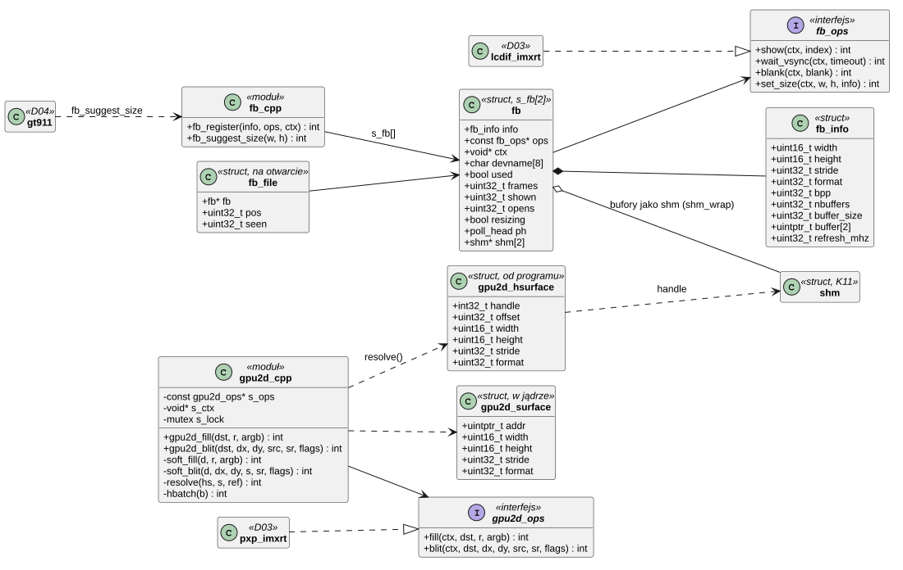
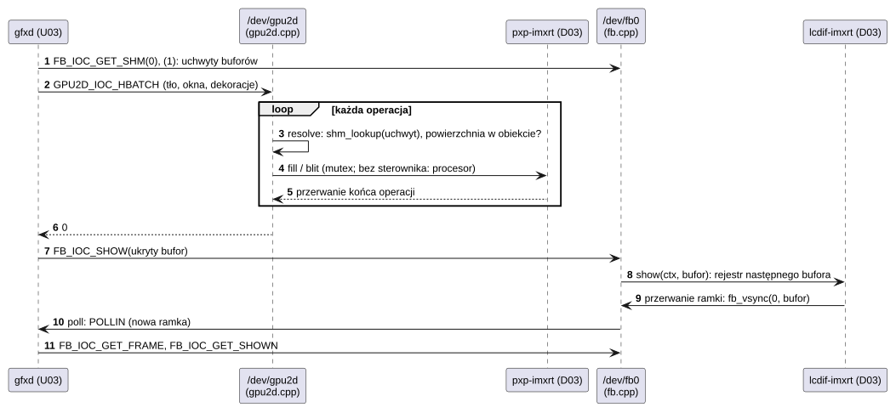

# S03 Ekran i akcelerator 2D

## 1. Identyfikacja

| | |
|---|---|
| Identyfikator | S03 |
| Warstwa | L0, framework podsystemu |
| Pliki | `kernel/subsys/fb.cpp` (`/dev/fbN`), `kernel/subsys/gpu2d.cpp` (`/dev/gpu2d`) |
| Interfejs | `kernel/include/crtos/fb.h`, `kernel/include/crtos/gpu2d.h` |
| Implementacje sprzętowe | D03: `lcdif-imxrt` (ekran), `pxp-imxrt` (akcelerator) na i.MX RT1052; `ltdc-stm32` (ekran), `gpu2d-stm32` (NeoChrom GPU2D z DMA2D) na STM32H7S7 |

## 2. Odpowiedzialność

- **Bufory ramki** (`/dev/fb0`): rejestr wyświetlaczy (do 2), informacje (rozmiar, format,
  bufory), przełączanie buforów w następnej ramce, licznik ramek i `poll` na początek
  ramki, wygaszanie, udostępnienie buforów jako pamięci współdzielonej dla akceleratora.
- **Wybór trybu panelu** (`fb_suggest_size`): sterownik, który zna rozmiar zamontowanego
  panelu (dotyk GT911, D04), prosi o ten tryb; framework zmienia tryb `/dev/fb0` przez
  `set_size` sterownika (D03) tylko wtedy, gdy nikt nie używa ekranu (przy starcie, przed
  `gfxd`).
- **Akcelerator 2D** (`/dev/gpu2d`): wypełnianie prostokątów, kopiowanie z konwersją
  formatu, mieszanie ARGB, skalowanie (najbliższy piksel albo filtr dwuliniowy); jeden
  sterownik sprzętowy (PXP, NeoChrom) obsługuje wszystkich, a bez niego te same operacje
  wykonuje procesor.
- **Prymitywy 3D** (`GPU2D_IOC_PRIMS`, tylko ze sterownikiem, który je ma: NeoChrom):
  trójkąty i czworokąty z teksturą nałożoną w perspektywie (macierz 3×3 z piksela na teksel),
  rysowane po kolei, z mieszaniem; bez bufora głębokości.
- **Opis akceleratora** (`GPU2D_IOC_STATS`): nazwa, liczniki pracy i zdolności
  (`GPU2D_CAP_SCALE`: skalowanie w sprzęcie, `GPU2D_CAP_PRIMS`: prymitywy), żeby program
  wybrał drogę (np. emulator: obraz 1:1 bez sprzętowego skalowania).
- **Bezpieczeństwo DMA**: programy wskazują powierzchnie uchwytem pamięci współdzielonej
  i przesunięciem; jądro sprawdza, że cała powierzchnia leży w obiekcie, zanim akcelerator
  (urządzenie z własnym dostępem do pamięci) jej dotknie.

## 3. Wymagania

| ID | Wymaganie | Weryfikacja |
|---|---|---|
| REQ-S03-01 | Przełączenie bufora (`FB_IOC_SHOW`) działa od następnego początku ramki (bez rozrywania obrazu). | `kmon fbtest`, obserwacja ekranu |
| REQ-S03-02 | `poll` na `/dev/fb0` zgłasza `POLLIN`, gdy od ostatniego `FB_IOC_GET_FRAME` zaczęła się nowa ramka. | `gfxinfo` (U03, 58 fps) |
| REQ-S03-03 | Akcelerator wykonuje operację programu tylko na powierzchniach, które w całości leżą w obiektach pamięci współdzielonej, do których program ma uchwyt (`-EBADF`, `-EINVAL` inaczej). | przegląd kodu, `kmon gpu2dtest` |
| REQ-S03-04 | Operacje z adresami surowymi (`GPU2D_IOC_FILL/BLIT`) są dostępne tylko dla wątków jądra (`-EPERM`). | przegląd kodu |
| REQ-S03-05 | Po wyrejestrowaniu ekranu jego bufory przestają być osiągalne przez wcześniej wydane uchwyty (`shm_revoke`). | przegląd kodu |
| REQ-S03-06 | Bez sterownika akceleratora `/dev/gpu2d` działa na procesorze (te same wyniki). | `kmon gpu2dtest` |
| REQ-S03-07 | `fb_suggest_size` zmienia tryb `/dev/fb0` tylko wtedy, gdy żaden plik ekranu nie jest otwarty i żaden program nie trzyma jego bufora jako pamięci współdzielonej; inaczej zwraca `-EBUSY`, a tryb się nie zmienia. Otwarcie ekranu w trakcie zmiany kończy się `-EAGAIN`. | przegląd kodu; `kmon fb 480x272` przy działającym `gfxd`: odmowa, po zakończeniu `gfxd`: zmiana (02.10.2026) |
| REQ-S03-08 | `GPU2D_IOC_PRIMS`: akcelerator czyta tekstury tylko z tablic, które w całości (wszystkie warstwy) leżą w obiektach pamięci współdzielonej programu, i pisze tylko do celu sprawdzonego jak w REQ-S03-03, wewnątrz prostokąta przycięcia; prymityw z teksturą lub warstwą spoza tablic, nieznanym trybem mieszania albo liczbą nieskończoną lub NaN w macierzy jest pomijany. Tablica prymitywów i wierszy musi leżeć w pamięci programu (`-EFAULT`). | przegląd kodu, `gpuprims` (04.10.2026) |
| REQ-S03-09 | Prymityw wypełnia piksel, gdy jego środek leży wewnątrz figury; teksel to wartość macierzy w środku piksela (najbliższy albo dwuliniowo), z powtarzaniem tekstury lub bez. | `gpuprims`: tekstura afiniczna 0/16384 różnic, perspektywa 5/16384 (zaokrąglenia na krawędziach tekseli), trójkąt 0/16384 (04.10.2026) |
| REQ-S03-10 | Bez prymitywów w sterowniku `GPU2D_IOC_PRIMS` zwraca `-ENOSYS`, a `GPU2D_IOC_STATS` nie podaje `GPU2D_CAP_PRIMS`. | przegląd kodu |

## 4. Interfejs udostępniany

### 4.1 Ekran (`crtos/fb.h`)

| Funkcja / ioctl | Kontekst | Opis |
|---|---|---|
| `fb_register(info, ops, ctx)` | `probe` | `/dev/fbN`, zwraca indeks albo `-ENOSPC` |
| `fb_unregister(index)` | `remove` | usunięcie, odwołanie buforów |
| `fb_vsync(index, shown)` | ISR sterownika | początek ramki: licznik, bufor na ekranie, `poll_notify` |
| `fb_show`, `fb_wait_vsync`, `fb_blank`, `fb_get_info` | wątek | dla jądra |
| `fb_suggest_size(w, h)` | wątek (`probe` sterownika) | zamontowany panel ma ten rozmiar: zmiana trybu `/dev/fb0`; 0, `-ENOENT` (brak trybu), `-EBUSY` (ekran w użyciu), `-ENODEV` |
| `FB_IOC_GET_INFO` | program | `struct fb_info` (np. 800×480 albo 480×272, RGB565, 2 bufory, ok. 59 Hz) |
| `FB_IOC_SHOW` (arg: bufor) | program | pokaż od następnej ramki |
| `FB_IOC_GET_FRAME`, `FB_IOC_GET_SHOWN` | program | licznik ramek (i zapamiętanie dla `poll`), bufor na ekranie |
| `FB_IOC_WAIT_VSYNC`, `FB_IOC_BLANK` | program | czekanie na ramkę (100 ms), wygaszenie |
| `FB_IOC_GET_SHM` | program | uchwyt pamięci współdzielonej bufora (dla `/dev/gpu2d`) |
| `read`, `write`, `lseek` | program | dostęp do bufora 0 |

`struct fb_ops`: `show(ctx, index)`, `wait_vsync(ctx, timeout)`, `blank(ctx, on)`
i opcjonalnie `set_size(ctx, w, h, info)`: zmiana na tryb panelu o tym rozmiarze, opis nowych
buforów w `info`.

### 4.2 Akcelerator (`crtos/gpu2d.h`)

| Funkcja / ioctl | Kontekst | Opis | Wynik |
|---|---|---|---|
| `gpu2d_register(ops, ctx)`, `gpu2d_unregister()` | `probe`/`remove` | jeden sterownik | 0, `-EBUSY` |
| `gpu2d_fill(dst, rect, argb)`, `gpu2d_blit(dst, dx, dy, src, sr, flags)` | wątek jądra | adresy surowe, szeregowane | 0 / błąd |
| `GPU2D_IOC_HFILL`, `GPU2D_IOC_HBLIT` | program | powierzchnie jako (uchwyt shm, przesunięcie, wymiary, format) | 0, `-EBADF`, `-EINVAL` |
| `GPU2D_IOC_HBATCH` | program | do 64 operacji (`GPU2D_OP_FILL`, `_BLIT`, `_SCALE`) w jednym wywołaniu (cała klatka) | 0, pierwszy błąd, `-EFAULT` |
| `GPU2D_IOC_STATS` | program | `struct gpu2d_stats`: nazwa, paczki, operacje, zlecenia, czas pracy, trafienia pamięci podręcznej akceleratora, `caps` | 0 |
| `GPU2D_IOC_PRIMS` | program | `struct gpu2d_prims_req`: cel, przycięcie, flagi, tablica prymitywów (i opcjonalnie ich wierszy) w pamięci programu, do 8 tablic tekstur w pamięci współdzielonej | 0, `-ENOSYS`, `-EBADF`, `-EINVAL`, `-EFAULT` |
| `GPU2D_IOC_FILL`, `GPU2D_IOC_BLIT` | wątek jądra | adresy surowe | `-EPERM` dla programów |

Formaty: `GPU2D_FMT_RGB565`, `XRGB8888`, `ARGB8888`; `GPU2D_BLEND` = mieszanie z kanałem
alfa źródła, `GPU2D_FILTER` = skalowanie z filtrem dwuliniowym. `struct gpu2d_ops`: `fill`,
`blit`; opcjonalnie `batch` (cała paczka jako jedno zlecenie), `stats`, `prims`.

**Prymityw** (`struct gpu2d_prim`, 64 bajty: tablica wyrównana do 32 bajtów ma nagłówek
każdego w jednej linii pamięci podręcznej):

| Pole | Znaczenie |
|---|---|
| `flags` | `GPU2D_PRIM_QUAD` (4 punkty, inaczej trójkąt), `_SMOOTH` (filtr dwuliniowy), `_REPEAT` (tekstura się powtarza), `_AGAIN` (punkty poprzedniego prymitywu i jego macierz przeskalowana: `u' = again[0]·u + again[1]`, `v' = again[2]·v + again[3]` — druga tekstura na tej samej ścianie; czytany jest tylko nagłówek) |
| `blend` | `GPU2D_PRIM_COPY` (cel = teksel), `_ALPHA` (s·a + d·(1−a)), `_PREMUL` (s + d·(1−a), kolor przemnożony przez alfę) |
| `tex`, `layer` | tablica tekstur i obraz w niej |
| `x[4]`, `y[4]` | punkty w pikselach × 16 (stały przecinek 12.4), wypukła figura w kolejności obwodu |
| `m[9]` | macierz: `u = (m0·x + m1·y + m2)/q`, `v = (m3·x + m4·y + m5)/q`, `q = m6·x + m7·y + m8` |

Tablica tekstur (`struct gpu2d_htexarray`): powierzchnia pierwszego obrazu (uchwyt,
przesunięcie, wymiary, krok, format) i liczba warstw leżących kolejno po sobie. Flaga
żądania `GPU2D_PRIMS_DISCARD`: prymitywy pokrywają cały prostokąt, więc sterownik nie wczytuje
starej zawartości celu. Opcjonalna tablica `rows` (pierwszy i ostatni + 1 wiersz każdego
prymitywu; prymityw `AGAIN` ma wiersze poprzedniego) pozwala sterownikowi podzielić prymitywy
na pasy bez czytania ich samych.

## 5. Interfejsy wymagane

K11 (`shm_wrap`, `shm_revoke`, `shm_lookup`), K08 (uchwyty, `uaccess_ok`), K12 (`poll`),
K13 (`devfs_register`), K06 (mutex akceleratora). Sterownik NeoChrom: D01 (pamięć kafelków
w AXI SRAM1 zależna od option bytes), K07 (`kmalloc` dla list poleceń i podziału na pasy).

## 6. Struktura statyczna

*Źródło: [S03/struktura-statyczna.puml](../diagramy/S03/struktura-statyczna.puml)*

## 7. Zachowanie dynamiczne

### 7.1 Klatka kompozytora

*Źródło: [S03/klatka-kompozytora.puml](../diagramy/S03/klatka-kompozytora.puml)*

## 8. Implementacja

- Bufory ekranu leżą w SDRAM bez pamięci podręcznej (sterownik), więc zapis procesora
  i odczyt LCDIF nie wymagają operacji na cache.
- `buffer_shm` tworzy obiekt pamięci współdzielonej bufora przy pierwszym użyciu
  (`shm_wrap`) i trzyma jedno odwołanie; bufor ekranu (480×272: 255 KB, 800×480: 750 KB)
  nie spełnia reguł regionów MPU, więc programy nie mogą go zmapować, a jedynie przekazać
  uchwyt akceleratorowi.
- `fb_suggest_size`: pod `irq_lock` sprawdza licznik otwarć (`opens`, zmieniany w `open`
  i `close`), flagę `resizing` i obiekty buforów. Obiekt, który poza frameworkiem nikt już
  nie trzyma (`shm_unshared`, K11: programy go zamknęły), jest odbierany (`shm_revoke`)
  i zwalniany. Potem ustawia `resizing`, poza blokadą woła `set_size` sterownika i podmienia
  `info`. Wynik trafia do logu jądra (`fb0: now WxH`, `fb0: stays ...`).
- `resolve` sprawdza format, wymiary, parzystość przesunięcia i kroku oraz
  `offset + stride × (h − 1) + szerokość × bpp ≤ rozmiar obiektu` (arytmetyka 64-bitowa).
- Programowe zastępstwo (`soft_fill`, `soft_blit`) obsługuje te same formaty i mieszanie
  (piksel po pikselu).
- Czas złożenia klatki przez `gfxd` z PXP: ok. 1,7 ms (ekran 58,7 Hz).
- `hprims` kopiuje żądanie (program może je zmieniać w trakcie), sprawdza cel, każdą tablicę
  tekstur ze wszystkimi warstwami (`offset + stride × (h·warstwy − 1) + szerokość × bpp`)
  i zakres tablicy prymitywów (`uaccess_ok`), trzyma odwołania do obiektów do końca
  wywołania i woła `prims` sterownika pod blokadą akceleratora.

### 8.1 NeoChrom (`gpu2d-stm32`, STM32H7S7)

- Bez biblioteki producenta: sterownik sam pisze listy poleceń GPU (kodowanie ustalone
  z NemaGFX i sprawdzone na płytce). Zwykłe operacje (wypełnienie, kopia, mieszanie) robi
  DMA2D, skalowanie i prymitywy NeoChrom. Blender ROP: czynnik źródła | czynnik celu << 8
  w numeracji NemaGFX (0x504: zwykła alfa, 0x501: alfa przemnożona).
- Dwie listy poleceń po 8 KB w AXI SRAM na zmianę: procesor pisze jedną, GPU wykonuje drugą.
  Listy w PSRAM (bez cache i z cache) kosztowały procesor ok. 2,6 µs na prymityw (zapis słowo
  po słowie albo odczyt linii przy zapisie).
- Prymitywy: trójkąt to polecenie `DRAW` 4, czworokąt 5, punkty w 16.16, tekstura przez pełną
  macierz 3×3 (rejestry 0x160–0x180; zwykłe kopie i skalowanie ustawiają trzeci wiersz na
  0, 0, 1). Powtarzanie tekstury to bit 18 `SRC_FMT`, filtr dwuliniowy bit 16.
- **Kafelki**: z celem w PSRAM GPU potrzebował 6–14 µs na mały prymityw (piksele pisane
  i mieszane pojedynczo), z celem w AXI SRAM 2–2,5 µs. Cel jest więc rysowany pasami w 64 KB
  pamięci na chipie (górna połowa AXI SRAM1, `reg` 3 węzła GPU, jest AXI SRAM, gdy option
  bytes nie oddają całego SRAM1 na ITCM; D01). DMA2D wczytuje pas (chyba że `DISCARD`)
  i odsyła go całymi liniami; każdy pas dostaje swoje prymitywy w ich kolejności (podział
  na pasy z tablicy `rows` albo z nagłówków prymitywów).
- Prymityw jest czytany z pamięci programu raz, kopiowany i dopiero potem sprawdzany;
  macierz i punkty idą do listy bez porównania z cieniem rejestrów, tekstura i mieszanie
  przez cień (powtarzają się).
- Pamięć podręczna GPU (ICACHE) jest czyszczona przed każdą listą; mieszanie z pikselami
  narysowanymi wcześniej w tej samej liście działa poprawnie (`gpuprims`).

## 9. Obsługa błędów i mechanizmy bezpieczeństwa

| Sytuacja | Reakcja |
|---|---|
| powierzchnia wychodzi poza obiekt shm | `-EINVAL`, akcelerator nie startuje |
| uchwyt nie jest pamięcią współdzieloną / odwołaną | `-EBADF` |
| za duża paczka | `-EINVAL` (> 64) |
| operacja surowa z programu | `-EPERM` |
| bufor spoza zakresu | `-EINVAL` |
| brak operacji w sterowniku | `-ENOTSUP`; prymitywów: `-ENOSYS` |
| prymityw z teksturą lub warstwą spoza tablic, złym trybem, liczbą nieskończoną / NaN | pominięty (pozostałe rysowane) |
| tablica tekstur poza obiektem shm, więcej niż 8 tablic, więcej niż 65535 prymitywów | `-EINVAL` |
| tablica prymitywów lub wierszy poza pamięcią programu | `-EFAULT` |
| brak pamięci na podział na pasy | rysowanie całego celu naraz, w PSRAM (wolniej) |
| zmiana trybu, gdy ekran jest otwarty albo bufory są u programów | `-EBUSY`, tryb bez zmian, wpis w logu |
| otwarcie ekranu w trakcie zmiany trybu | `-EAGAIN` |
| panel bez trybu tego rozmiaru, sterownik bez `set_size` | `-ENOENT`, tryb bez zmian |

## 10. Konfiguracja

`MAX_FB` (2), `FB_MAX_BUFFERS` (2), `GPU2D_BATCH_MAX` (64), `GPU2D_PRIMS_MAX` (65535),
`GPU2D_PRIM_TEXARRAYS` (8). Sterownik NeoChrom: `CL_WORDS` (2048 słów na listę),
`GPU_BANDS_MAX` (64 pasy), pamięć kafelków z drzewa urządzeń (`reg` 3, 64 KB);
`crtos,no-gpu-cache`, `crtos,no-dma2d`.

## 11. Weryfikacja

- `crtos kmon fbtest` (wzór testowy, częstotliwość odświeżania, wypełnienie
  akceleratorem), `crtos kmon gpu2dtest` (operacje na buforach w RAM, porównanie
  z wynikiem oczekiwanym).
- `crtos run gfxinfo -b` (U03): czasy faz składania, liczba klatek.
- `crtos shot`: zrzut ekranu przez sondę (odczyt bufora pokazywanego przez LCDIF).
- `crtos kmon fb [WxH]` (K19): bieżący tryb i ręczna zmiana; 02.10.2026: odmowa przy
  działającym `gfxd`, po jego zakończeniu 10 zmian 480×272 ↔ 800×480 (D03).
- `gpuprims` (`tests/gpuprims`, 04.10.2026, STM32H7S78-DK): tekstura afiniczna i
  perspektywiczna, trójkąt, mieszanie alfa i przemnożone, mieszanie z pikselami tego samego
  wywołania (8 testów zaliczonych) oraz czasy: cel 400×217, kafelki — 1×1 ok. 2,9 µs,
  16×16 ok. 4,3 µs, 16×16 przemnożone z filtrem ok. 4,6 µs, 64×64 ok. 24 µs na prymityw.
- Voxel (renderer na GPU, ta sama wyspa): ok. 3400 ścian i 6700 prymitywów na klatkę;
  21 kl./s w połowie rozdzielczości, 16 kl./s w pełnej (procesor: 22 i 11).

## 12. Ograniczenia i znane problemy

- Jeden akcelerator dla wszystkich; operacje są szeregowane.
- Tryb ekranu zmienia się tylko, gdy nikt go nie używa: przy działającym `gfxd` (zawsze, poza
  chwilą startu) nie da się go zmienić bez zatrzymania serwera grafiki.
- Paczka `HBATCH` jest czytana z pamięci programu w trakcie przetwarzania (każda operacja
  jest sprawdzana osobno, więc zmiana paczki przez inny wątek programu nie omija kontroli).
  To samo dotyczy prymitywów.
- Prymitywy nie mają zastępstwa na procesorze ani bufora głębokości: program sam ustala
  kolejność rysowania.
- NeoChrom potrzebuje ok. 2 µs na prymityw niezależnie od jego wielkości; przy kilku
  tysiącach prymitywów na klatkę to on ogranicza szybkość (wywołanie jest synchroniczne).
